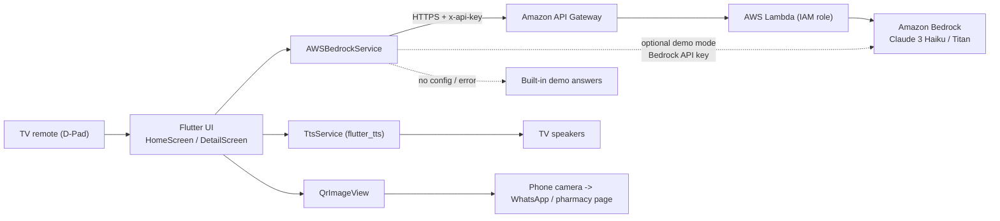

# CareTV AI

**An AI caretaking assistant for the living-room TV.** CareTV AI turns a Fire TV / Android TV into a family care companion. Pick a situation with the remote, get calm, structured guidance from **AWS Bedrock**, hear it read aloud on the TV speakers, and scan a QR code to order medicines or supplies from your phone.

Built for the **Amazon Developer Hackathon 2026** - Fire TV Track, AWS Builder and Open Source Challenge.

> **Disclaimer:** CareTV AI provides general information only. It does not diagnose, is not a medical or veterinary device, and is not a substitute for professional advice. In an emergency, call your local emergency number.

---

## Features

| Feature | Details |
| --- | --- |
| 10-foot TV UI | Large type, safe-area padding, a 1280 x 720 design canvas that scales to 720p / 1080p / 4K |
| D-Pad navigation | Flutter directional focus with scale-up, glowing border and brighter background on the focused item |
| Four care categories | Household Health, Elderly Care, Livestock & Farm Care, Emergency First Aid |
| AWS Bedrock | Claude 3 Haiku (`anthropic.claude-3-haiku-20240307-v1:0`) or Amazon Titan text models |
| Voice | `flutter_tts` reads each answer aloud, tuned for TV speakers (slower rate, chunked text) |
| Mobile hand-off | Dynamic QR code (WhatsApp or web link) to order supplies from a phone |
| Offline demo mode | Realistic built-in answers for every concern when AWS is not configured or unreachable |
| No binary assets in code | Logo is drawn with `CustomPainter`; PNG icons are generated by a script |

## Architecture



```text
+----------------+      +--------------------+      +-------------------+
|  TV remote     | ---> |  Flutter app       | ---> |  API Gateway      |
|  (D-Pad / OK)  |      |  (Fire OS / ATV)   |      |  -> Lambda        |
+----------------+      |                    |      |  -> Bedrock       |
                        |  TTS  |  QR code   |      +-------------------+
                        +--------------------+
                          |            |
                     TV speakers   Phone (order)
```

**Why a proxy?** Anything inside an APK can be extracted. The recommended setup keeps AWS credentials in a Lambda IAM role, and the app only knows an API Gateway URL (optionally with a usage-plan API key).

## Project structure

```text
caretv_ai/
|-- pubspec.yaml
|-- README.md
|-- LICENSE
|-- analysis_options.yaml
|-- tools/generate_assets.py          # launcher icons + TV banner + store art
|-- store_assets/                     # 512x512 icon, 1280x720 banner
|-- android/app/src/main/
|   |-- AndroidManifest.xml           # leanback + touchscreen-optional
|   `-- res/                          # generated icons and tv_banner.png
`-- lib/
    |-- main.dart                     # theme, providers, 1280x720 canvas
    |-- models/care_option.dart       # categories, symptoms, prompts
    |-- services/
    |   |-- aws_bedrock_service.dart  # proxy / direct / offline fallback
    |   `-- tts_service.dart          # text-to-speech
    |-- widgets/tv_app_logo.dart      # CustomPainter logo + banner widget
    `-- screens/
        |-- home_screen.dart          # D-Pad category grid
        `-- detail_screen.dart        # AI guidance, voice, QR
```

## Getting started

Requirements: Flutter 3.x (Dart `>=3.0.0 <4.0.0`) and the Android SDK.

This repository ships the Dart sources, manifest and generated icons. The Gradle scaffolding is created by Flutter. **Run `flutter create` once** inside the project folder; it keeps the files that already exist (including the TV manifest):

```bash
cd caretv_ai
flutter create --org com.caretv --project-name caretv_ai --platforms=android .
flutter pub get
```

Check that `android/app/src/main/AndroidManifest.xml` still contains the leanback entries below (if your Flutter version replaced it, copy it back from this repository):

```xml
<uses-feature android:name="android.hardware.touchscreen" android:required="false" />
<uses-feature android:name="android.software.leanback" android:required="true" />
<category android:name="android.intent.category.LEANBACK_LAUNCHER" />
```

Optional: regenerate the icons and banner after changing the logo:

```bash
pip install pillow numpy
python3 tools/generate_assets.py
```

### Run in offline demo mode (no AWS needed)

```bash
flutter run -d <fire-tv-ip>:5555
```

### Run with AWS Bedrock

```bash
flutter run -d <fire-tv-ip>:5555 \
  --dart-define=CARETV_API_URL=https://<api-id>.execute-api.<region>.amazonaws.com/prod/advice \
  --dart-define=CARETV_API_KEY=<optional-api-gateway-key> \
  --dart-define=CARETV_PHARMACY_WHATSAPP=<digits-only-international-number>
```

### Configuration (`--dart-define`)

| Name | Default | Purpose |
| --- | --- | --- |
| `CARETV_API_URL` | empty | API Gateway / Lambda proxy URL (recommended) |
| `CARETV_API_KEY` | empty | Optional API Gateway key, sent as `x-api-key` |
| `CARETV_BEDROCK_API_KEY` | empty | Bedrock API key for direct calls (**demo only**) |
| `CARETV_AWS_REGION` | `us-east-1` | Region for direct calls |
| `CARETV_MODEL_ID` | `anthropic.claude-3-haiku-20240307-v1:0` | Bedrock model; `amazon.titan-text-*` is also supported |
| `CARETV_PHARMACY_WHATSAPP` | `15551234567` | Demo placeholder. Digits only, no `+` |
| `CARETV_PHARMACY_URL` | empty | Web ordering page; takes priority over WhatsApp |

## AWS setup

1. **Enable model access.** In the Amazon Bedrock console, open *Model access* in your region and request access to *Claude 3 Haiku* (and/or *Titan Text*).
2. **Create the Lambda** (Python 3.12). Environment variables: `MODEL_ID=anthropic.claude-3-haiku-20240307-v1:0`, `BEDROCK_REGION=us-east-1`.

   ```python
   import json
   import os

   import boto3

   bedrock = boto3.client("bedrock-runtime", region_name=os.environ.get("BEDROCK_REGION", "us-east-1"))
   MODEL_ID = os.environ.get("MODEL_ID", "anthropic.claude-3-haiku-20240307-v1:0")


   def _response(status, payload):
       return {
           "statusCode": status,
           "headers": {"Content-Type": "application/json"},
           "body": json.dumps(payload),
       }


   def lambda_handler(event, context):
       try:
           payload = json.loads(event.get("body") or "{}")
           body = payload.get("body")
           if not isinstance(body, dict):
               return _response(400, {"error": "Missing 'body'"})

           # The model is fixed on the server; ignore any modelId sent by clients.
           result = bedrock.invoke_model(
               modelId=MODEL_ID,
               body=json.dumps(body),
               contentType="application/json",
               accept="application/json",
           )
           data = json.loads(result["body"].read())

           if "content" in data:  # Anthropic Claude
               text = "".join(p.get("text", "") for p in data["content"])
           else:  # Amazon Titan
               text = data["results"][0]["outputText"]
           return _response(200, {"text": text})
       except Exception as exc:  # noqa: BLE001
           print("error:", exc)
           return _response(500, {"error": "Model invocation failed"})
   ```

3. **IAM.** Give the Lambda role `bedrock:InvokeModel` on the model ARN, for example `arn:aws:bedrock:us-east-1::foundation-model/anthropic.claude-3-haiku-20240307-v1:0`, plus the basic Lambda logging policy.
4. **API Gateway.** Create a REST or HTTP API with `POST /advice` integrated with the Lambda (proxy integration). For a public demo add a **usage plan with an API key** and throttling (for example 2 requests/second) so nobody can run up your bill. Use the invoke URL as `CARETV_API_URL`.
5. **Test.**

   ```bash
   curl -X POST "$CARETV_API_URL" -H "x-api-key: $KEY" -H "Content-Type: application/json" \
     -d '{"body":{"anthropic_version":"bedrock-2023-05-31","max_tokens":200,"messages":[{"role":"user","content":[{"type":"text","text":"Say hello"}]}]}}'
   ```

### Direct mode (demo only)

Setting `CARETV_BEDROCK_API_KEY` makes the app call `https://bedrock-runtime.<region>.amazonaws.com/model/<modelId>/invoke` with a Bedrock API key as a bearer token. This is convenient for a quick demo, but the key is stored inside the APK. Use a short-lived key, restrict it, and **never commit it**. Use the proxy for anything public.

## Fire TV: install and run

1. On the Fire TV: *Settings > My Fire TV > About*, tap the device name 7 times, then enable *Developer Options > ADB debugging* (and *Apps from Unknown Sources* if needed).
2. Find the IP address under *About > Network*, then connect:

   ```bash
   adb connect <fire-tv-ip>:5555
   flutter devices
   ```

3. Debug run: `flutter run -d <fire-tv-ip>:5555`
4. Release APK:

   ```bash
   flutter build apk --release --dart-define=CARETV_API_URL=...
   adb install -r build/app/outputs/flutter-apk/app-release.apk
   ```

   Some older Fire TV sticks run a 32-bit userspace. If installation fails with an ABI error, build with `--target-platform android-arm`.

## D-Pad / remote controls

| Remote button | Home screen | Detail screen |
| --- | --- | --- |
| Up / Down / Left / Right | Move focus between category cards | Move between concerns, buttons and panels; Up / Down scrolls the answer when it is focused |
| OK / Select | Open the focused category | Load guidance for the focused concern, or press a button; on the answer panel it plays / stops the voice |
| Back | Exit the app | Return to categories (stops speech) |

## Amazon Developer Hackathon 2026 - submission details

- **Tracks:** Fire TV Track, AWS Builder, Open Source Challenge. Please verify the final category names and requirements against the official hackathon rules before submitting.
- **Problem:** Many households, especially multi-generational homes and small farms, do not have quick access to clear first-response guidance. The TV is already the shared screen in the room, readable from a distance and hands-free with voice.
- **Solution:** A 10-foot, remote-friendly assistant that gives structured, spoken guidance for household illness, elder care, livestock health and emergency first aid, then hands off to a phone via QR to order supplies.
- **AWS services:** Amazon Bedrock (Claude 3 Haiku / Titan), AWS Lambda, Amazon API Gateway, AWS IAM.
- **Fire TV fit:** Leanback launcher entry and banner, no touchscreen requirement, full D-Pad support with visible focus states, TV-sized typography, speaker output.
- **Open source:** MIT licensed, no proprietary assets (logo is code-drawn), fully documented setup.
- **Responsible AI:** Prompts forbid diagnosis claims, answers include warning signs and when-to-get-help sections, a disclaimer is visible on every screen, and emergency content starts with "call your emergency number".
- **Submission checklist:** public repository with this README and LICENSE; release APK; 2-3 minute demo video (home grid with D-Pad, a Bedrock answer with voice, QR scan on a phone); architecture diagram (above); short description of AWS usage.

## Notes and limitations

- Fonts: `google_fonts` downloads Inter at runtime. For a fully offline build, bundle the font files and set `GoogleFonts.config.allowRuntimeFetching = false`.
- Text-to-speech depends on the TTS engine available on the device. If none is present, the button shows "Voice Unavailable" and the app continues to work.
- The pharmacy QR uses a placeholder WhatsApp number by default. Set your own number or web URL before publishing.
- Offline demo answers are written for demonstration and are not a replacement for professional guidance.

## License

Released under the [MIT License](LICENSE).
